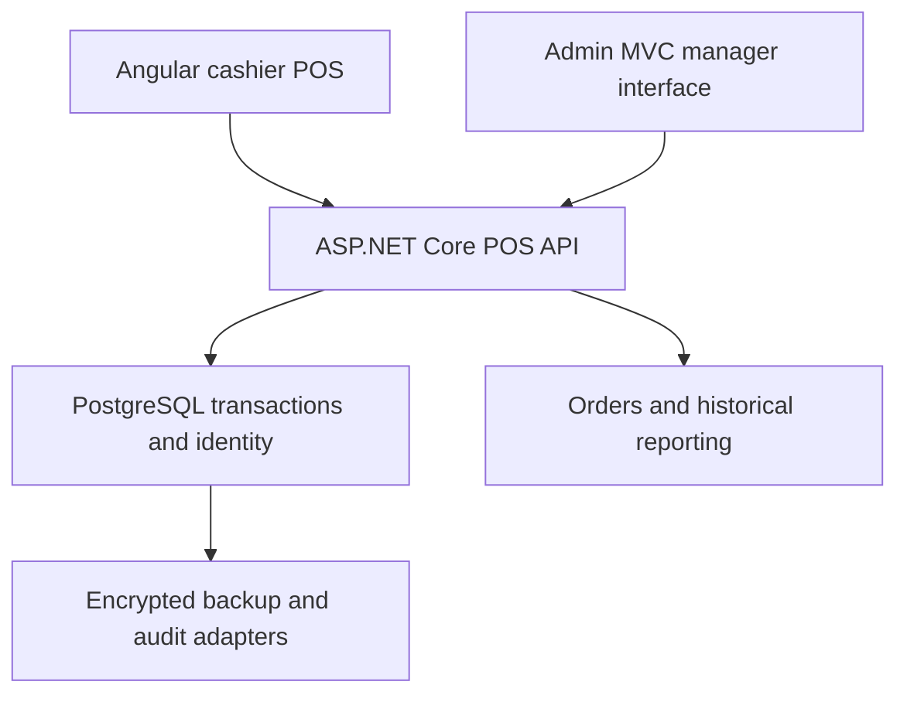

# MerchantOS POS

A bilingual English/Arabic cashier application built with Angular 22, ASP.NET Core 10 and PostgreSQL 17. Find products, assemble a cart, take cash or simulated-card payment, and issue a receipt while stock updates transactionally.

**Milestones 1–9 are merged. Milestone 10 is a retail-validation review candidate.** Isolated demo only; public production remains **NO-GO**. Card payments are simulated; no real card details are collected. No public deployment or automatic merge is part of this candidate.

## Try the retail workflows

Use the [private HTTPS demo setup and guided walkthrough](docs/retail/demo.md). It generates disposable native accounts and fictional retail data, preserves Administrator MFA and provides explicit health/reset commands. No permanent demo passwords are published.

- **Cashier:** search/category browse, quantity/remove controls, 0/5/10% discount, 15% VAT, cash/change or simulated card, receipt/print and English/Arabic RTL. Uncertain checkout retains its exact request across same-tab reload and offers safe reconciliation retry.
- **Manager:** MFA, Overview, product edits, version-checked stock adjustment with reason/review, audit history, complete order history, Asia/Riyadh reporting and filtered CSV.
- **Reviewer:** [acceptance matrix](docs/retail/journeys-and-uat.md), [confirmed defects](docs/retail/defects-and-exploration.md), [accessibility assessment](docs/retail/accessibility.md), [performance evidence](docs/retail/performance.md), [release limitations](docs/retail/readiness.md).

## How the applications fit together

POS is the sole identity/MFA and business-data authority. Admin holds restricted pending-login tickets until POS confirms MFA; it never becomes a second identity service. Checkout reads authoritative prices and locks inventory inside one transaction. Historical receipts retain their original prices. Private HTTPS staging and encrypted backup/recovery are tested separately from the loopback UI suites.

## Evidence and scope

[Actual browser screenshots and gallery](docs/retail/screenshots.md) cover desktop 1440×900, tablet 768×1024 and mobile 390×844, plus Arabic and narrow POS reflow. Screenshots are from the running applications, not generated mockups. The M9 baseline retains 48 POS/69 Admin .NET tests, 72 database identity assertions, 21 Angular tests, 24 POS/109 Admin browser cases, 383 reporting, 99 management, 51 operational and 369 HTTPS recovery assertions. M10 adds targeted retail/keyboard/axe checks; final counts and exact source revisions belong in the PR/CI evidence.

Independent human cashier/manager acceptance and manual screen-reader testing remain pending. CI timing is not a production SLA. Real off-host durability, independent custody and live on-call routing still require external evidence; the staging-only vulnerability exception is not a production clearance.

## Engineering details

[Authentication/MFA](docs/authentication.md) · [Recovery](docs/mfa-recovery.md) · [Threat model](docs/identity-threat-model.md) · [Operations](docs/operations/architecture.md) · [Release policy](docs/operations/readiness.md) · [Dependency review](docs/dependency-review.md) · [Project history](PROJECT_STATUS.md).
